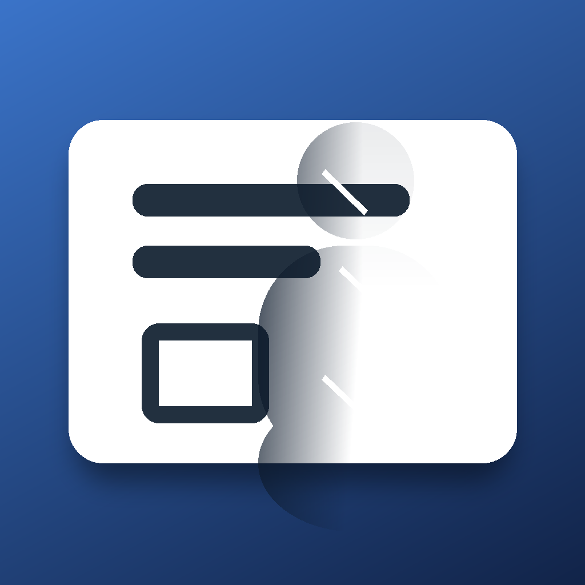

# DigiBoard iOS

移动端「数字无遮挡白板」系统的 **iOS 原生实现**。

> 相机取景 → 人像分割 → 时序背景重建（去遮挡）→ 透视校正 → 图像增强 → 全屏显示

本仓库是 [Me106y/DigiBoard](https://github.com/Me106y/DigiBoard) 的 Android 版在 iOS 上的
**算法对等、实现重写**版本。不是 Kotlin→Swift 的逐行翻译，而是用现代图形栈重写同一条算法链。

## 文档

| 文件 | 说明 |
| --- | --- |
| [`PRD.html`](PRD.html) | **产品与移植文档（推荐阅读，含导航与打印）** |
| [`PRD.md`](PRD.md) | 同一份文档的 Markdown 母本 |
| [`docs/glsl-to-msl.md`](docs/glsl-to-msl.md) | 28 个 GLSL 着色器的逐条移植对照 |

打开方式：

```bash
open PRD.html
```

## 图标



概念：**白板 + 正在被擦除的人影**——深色人像自左向右渐隐，板上的笔迹从人像身下透出来，
正是这个 App 在做的事。用脚本绘制而非生成式出图，保证几何精确、小尺寸清晰、可复现：

```bash
scripts/.venv/bin/python scripts/assets/make_app_icon.py
```

源图在 `DigiBoard/Resources/Assets.xcassets/AppIcon.appiconset/`（1024×1024，无透明通道，
其余尺寸由 Xcode 自动生成）。

## 技术栈

- **图形**：Metal（`MTKView` + `CVMetalTextureCache`），21 个 MSL 着色器，26 个管线节点
- **推理**：Core ML（`PP-HumanSegV2 portrait`，pdmodel → ONNX → `.mlpackage`），ANE 加速
- **相机**：AVFoundation，1920×1080 @ 30fps，`32BGRA` 零拷贝
- **界面**：SwiftUI 外壳 + UIKit `MTKView` 画布
- **几何**：Swift + `simd`（霍夫直线、最大四边形、单应矩阵）

**零第三方二进制依赖。**

## 当前状态

**已收敛为纯自动管线，并支持离线视频测试（可在模拟器直接验证整条链路）。**

- 输入：**实时视频**（相机）**或 离线视频**（分段控件切换；模拟器无相机时默认走内置视频）
- 处理：人像分割 → 时序背景重建（去遮挡）→ 白平衡 / 自适应二值化 / 色彩还原
- 不再包含：角点检测、透视校正、拖动与点击交互（已按需求移除）

### 视频测试

内置测试素材 `DigiBoard/Resources/sample_whiteboard.mp4`（真人横向走过带笔迹的白板，6 秒循环）。
也可以点卡片上的「更换」导入自备视频；导入的文件会被拷贝到 App 沙盒，不受文件选择器
安全作用域与临时收件箱的影响。模拟器直接运行即可看到完整效果：

```bash
xcodebuild -project DigiBoard.xcodeproj -scheme DigiBoard \
  -destination 'platform=iOS Simulator,name=iPhone 17' build
```

**去遮挡实测**（对照合成时使用的干净白板背景真值）：

| 指标 | 结果 |
| --- | --- |
| mask 与真实人像 IoU | 0.838 |
| 人像区去除率 | **86%** |
| 非人像区（背景用当前帧）偏差 | 1.2 |
| 帧率 | 30fps |

### 分期交付状态

| 期 | 内容 | 状态 |
| --- | --- | --- |
| P0 | 模型闸门：pdmodel → ONNX → Core ML | ✅ 完成（ONNX↔Core ML 不一致像素 0.073%、前景 IoU 0.9926） |
| P1 | 渲染骨架 + 静态图 → mask | ✅ 完成（模拟器实测 mask 前景 9.9%） |
| P2 | 相机链路 + 去遮挡闭环 | ✅ 完成（模拟器视频素材实测去除率 86%，30fps） |
| P3 | 透视校正 | ⛔ 已按需求移除 |
| P4 | 图像增强 | ✅ 完成（白平衡 / 自适应二值化 / 色彩还原） |
| P5 | 交互与收尾 | ✅ 完成（视频测试按钮 + 逐级调试视图 + 单测 + 着色器对照文档） |

跑测试：

```bash
xcodebuild test -project DigiBoard.xcodeproj -scheme DigiBoard \
  -destination 'platform=iOS Simulator,name=iPhone 17'
```

详见 [PRD](PRD.html) 的「分期计划与验收标准」。

## 目录结构

```
DigiBoard.xcodeproj     手写工程 + 同步文件夹（新增源文件无需改工程）
DigiBoard/              App 源码（App / Camera / Render / Pipeline /
                        Segmentation / Geometry / Shaders / Resources）
DigiBoardTests/         单元测试（几何、单应、纹理池）
docs/glsl-to-msl.md     28 个着色器的逐条移植对照
scripts/                模型转换与诊断脚本
PRD.md / PRD.html       本文档
```

## 环境

- Xcode 26.3 / iOS SDK 26.2 / Swift 6.2
- 最低部署目标 iOS 17.0
- 真机验证机：iPhone 16（Team `UW345FU9VD`，自动签名）

## 许可

上游项目为 Apache 2.0，本移植版沿用同一许可。
